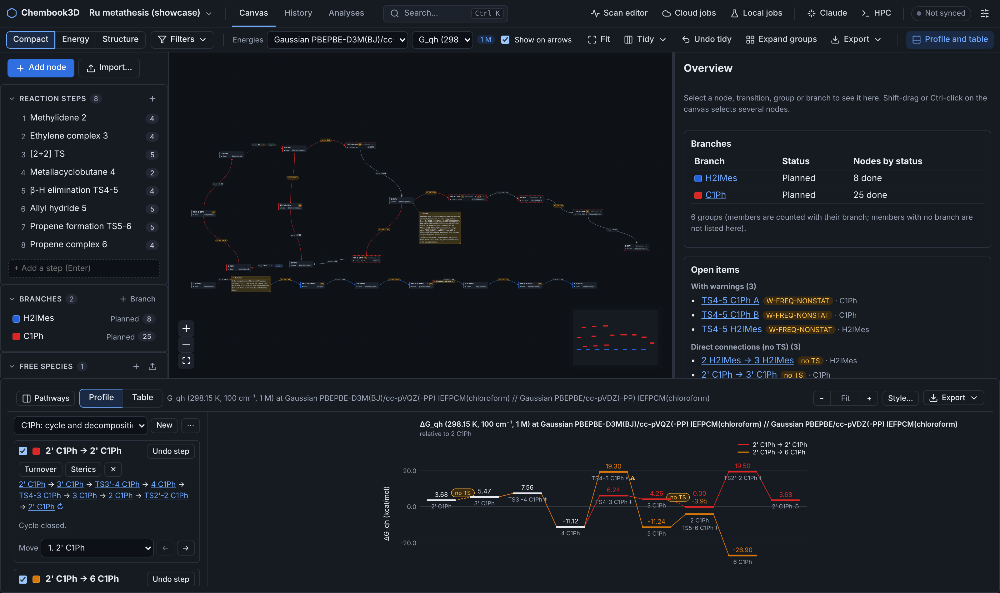
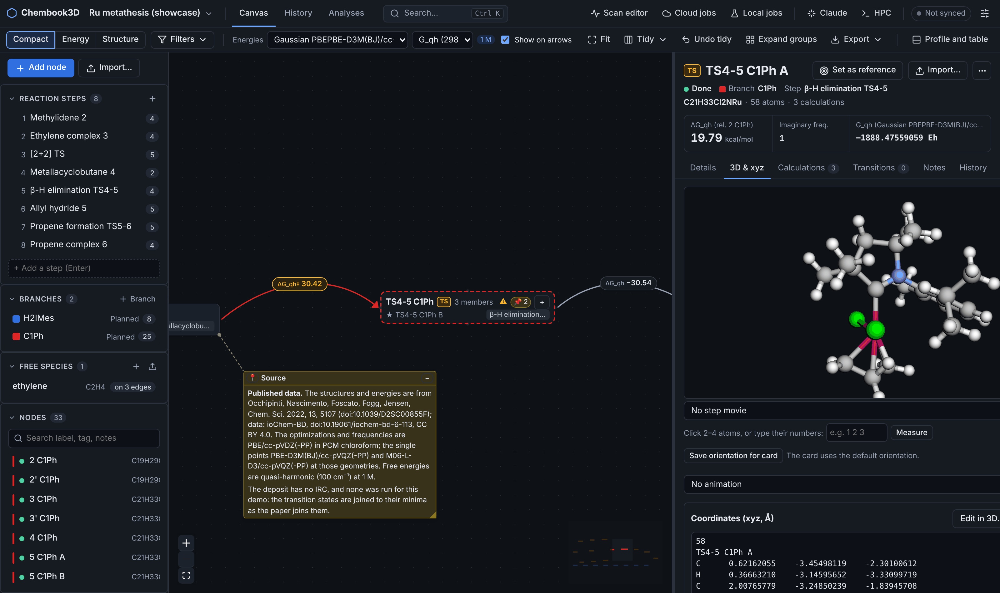
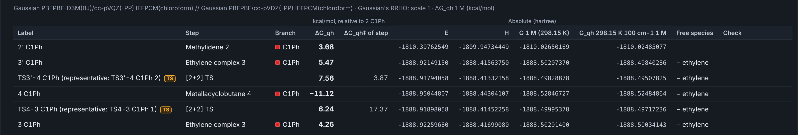
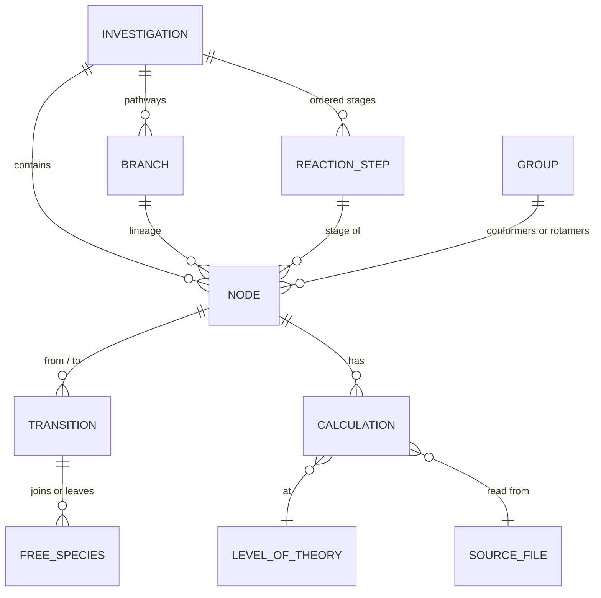
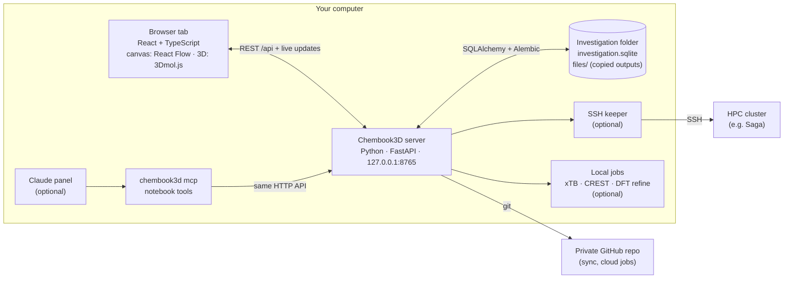
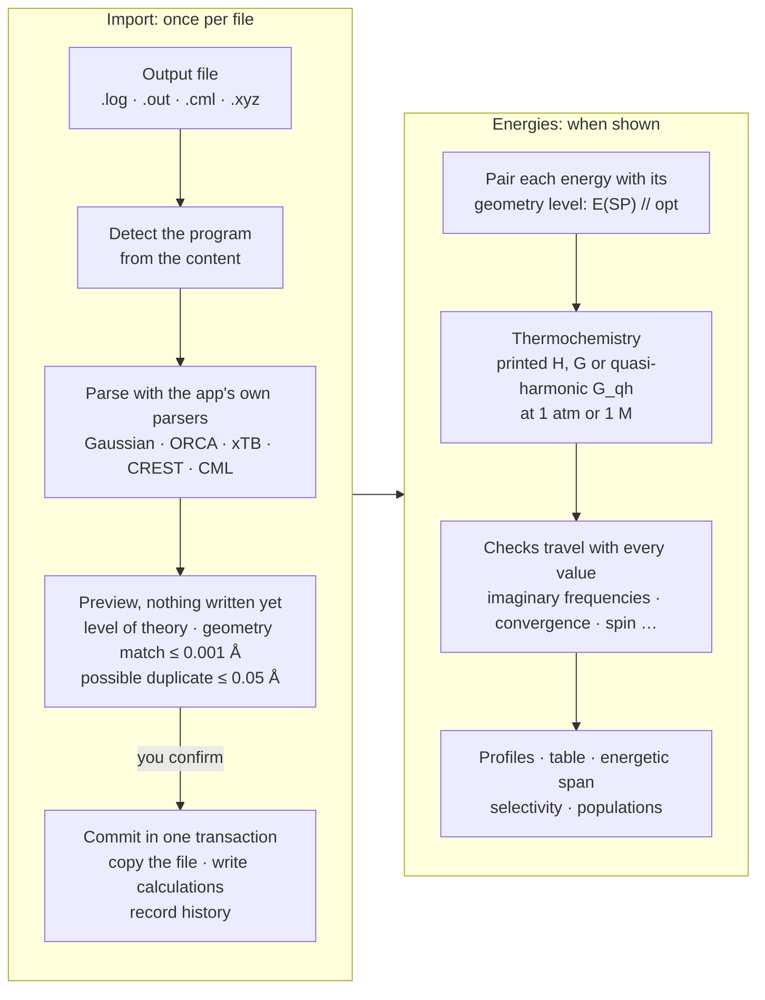

# Chembook3D

[](https://github.com/jonas-ekeli/Chembook3D/actions/workflows/ci.yml)
[](LICENSE)

A local-first notebook for computational chemistry mechanism investigations. You lay out a
reaction mechanism on an infinite 2D canvas, attach the calculations behind each structure, look
at every structure in 3D, and get energy profiles, tables and analyses computed straight from the
output files, at one level of theory at a time.



<sub>The showcase investigation, built from the published calculations of Occhipinti *et al.*,
*Chem. Sci.* 2022 (see [Data credits](#data-credits)): two Ru metathesis catalysts as two
branches, rotamer groups, ethylene joining and leaving, and the closed cycle's ΔG_qh profile.</sub>

**Contents:** [What it does](#what-it-does) ·
[Key ideas](#key-ideas) ·
[How it is built](#how-it-is-built) ·
[From output file to energy](#from-output-file-to-energy) ·
[How energies are computed](#how-energies-are-computed) ·
[Validation and checks](#validation-and-checks) ·
[Testing](#testing) ·
[Limits](#limits) ·
[Install](#install-the-tools) ·
[User guide](docs/user-guide.md) ·
[Data credits](#data-credits)

## What it does

- **Keeps a mechanism study in one place.** Every structure is a card on a canvas, joined to the
  next by a transition. Reaction steps, branches (one per catalyst or pathway), groups of
  conformers and notes sit on the same canvas. The investigation is a normal folder you can copy,
  back up or sync through a private GitHub repository.
- **Reads your output files.** Gaussian, ORCA, xTB, CREST and ioChem-BD CML (Gaussian jobs).
  Geometries, energies, frequencies and thermochemistry come from the file, never typed in, and
  the file itself is copied into the investigation.
- **Computes energies by stated rules.** Relative energies only within one level of theory,
  quasi-harmonic free energies validated against a reference script, and a visible warning on
  every value that rests on something doubtful (a TS without exactly one imaginary frequency, an
  unconverged optimization, spin contamination, and more).
- **Analyses on top.** Energy profiles, the energetic span model (TOF, TDTS, TDI), selectivities
  (ΔΔG‡, ee/de), conformer populations and equilibration times, buried volume and steric maps.
- **Shows structures in 3D.** View, measure, overlay and animate (optimizations, scans, IRCs,
  normal modes). Coordinates are edited as text or in a small builder; editing a structure that
  already has calculations makes a new, derived node, so results stay with the geometry they
  belong to.
- **Records history.** Every change, by you, an import or Claude, is in an append-only history,
  and an import can be undone.

<table>
<tr>
<td width="50%"></td>
<td width="50%"></td>
</tr>
<tr>
<td><sub>A transition state with its relative ΔG_qh, imaginary-frequency count and 3D structure.</sub></td>
<td><sub>The energy table states its level, energy type and standard state, and shows the absolute values behind every relative one.</sub></td>
</tr>
</table>

## Key ideas



| Term | Meaning |
|---|---|
| **Investigation** | One study, one folder: a SQLite database plus copies of the imported output files. |
| **Node** | One structure (a minimum or a transition state) with its geometry, charge and multiplicity. A free species (ethylene, a product) is a node that joins or leaves on a transition. |
| **Transition** | A directed edge between two nodes: one elementary step. The step is kept separate from the reaction step it realises. |
| **Reaction step** | A stage of the mechanism ("Ethylene complex 3"). Nodes are placed on stages; profiles follow stages in order. |
| **Branch** | A line of descent, for example one catalyst. Each node belongs to one branch, and lineage is recorded as you work, never rebuilt from which conformer happens to be lowest. |
| **Group** | Conformers or rotamers of one state. A representative stands for the group; populations are Boltzmann weights. |
| **Calculation** | One job step read from a file (optimization, frequency, single point, scan, IRC), with its results. |
| **Level of theory** | Program, method, basis, dispersion, solvation model and solvent. A single point is paired with the level its geometry was optimized at, as in *SP level // geometry level*. |

## How it is built

Chembook3D is a Python server and a browser interface that run on your own computer. Nothing is
hosted, there is no account, and the server only listens on `127.0.0.1`.



- **One database per investigation.** All records live in `investigation.sqlite` inside the
  investigation folder; imported outputs are copied into `files/` with their SHA-256 checksum.
  Paths are stored relative, so a folder moves between Windows and Linux. Opening an older
  investigation backs up the database before upgrading its schema.
- **All rules live in the server.** Identity, lineage and energy rules are Python services; the
  interface only shows what the server computes. Claude, through `chembook3d mcp`, uses the same
  HTTP API as the interface, asks before deleting anything, and its changes are marked "claude"
  in the history.
- **The optional parts stay optional.** Sync, the HPC terminal, the Claude panel, cloud jobs and
  local jobs are each switched on by you, and the notebook works without any of them. See the
  [user guide](docs/user-guide.md).

Developers and coding agents: [docs/architecture.md](docs/architecture.md) is the same picture
with the module paths, and [docs/code-map.md](docs/code-map.md) says where each feature lives.

## From output file to energy



1. **Detect and parse.** The program is recognised from the file's content. The parsers are
   written for this app (not a general library), and every value the app uses is read from the
   file; if a value is missing, it is reported, not guessed.
2. **Match the geometry.** A calculation is attached to a node only if its final geometry matches
   the node's within 0.001 Å RMSD after alignment (same atoms in the same order). Within 0.05 Å it
   is flagged as a possible duplicate and you choose. A different geometry becomes a derived node.
3. **Preview, then commit.** You see the proposed nodes, levels and warnings before anything is
   written. The commit is one transaction, and the history entry it writes lets you undo the
   whole import later. A folder can be imported in one batch the same way.

## How energies are computed

**Only within one level of theory.** A relative energy is the difference of two values at the
same *composite level* (single-point level // geometry level) and the same energy type. If one
node lacks a value at that level, the difference is shown as n/a: the app never falls back to
another level or mixes levels to fill a gap. Calculations in another charge or multiplicity are
left out of a node's energies, and two spin states at one level give n/a rather than "the latest".

**Energy types.** E (electronic), H and G as printed by the program, and G_qh (quasi-harmonic).
A composite free energy combines the single point with the thermal correction from the frequency
job at the geometry level:

> G(SP // opt) = E(SP) + [G − E](frequency job at the opt level)

For MP2, double hybrids, CCSD(T) and similar, E is the method's own total energy, never the SCF
reference. Counterpoise and ONIOM jobs use their corrected or extrapolated totals.

**Quasi-harmonic free energy (G_qh).** Truhlar's method: real vibrational modes below a cutoff
(100 cm⁻¹ by default) are raised to the cutoff for the vibrational entropy only; the zero-point
and thermal energies use the frequencies as computed. Imaginary modes are left out and counted.
Temperature (298.15 K by default) and cutoff are set per investigation, and every change is in
the history. Linear molecules use the linear rotor. The method follows
[`docs/reference/thermochem_corr_G16.py`](docs/reference/thermochem_corr_G16.py), a script kept
verbatim as the reference.

**Standard state.** 1 atm (ideal gas) by default, and always labelled. Optionally 1 M, which adds
RT ln(24.4654) = 1.894 kcal/mol at 298.15 K to G and G_qh (never to E or H), at the temperature
each value was computed at. A free species can also be given its own concentration.

**Units.** Energies are stored in hartree as printed and converted with CODATA 2018 constants,
the same as the reference script (1 E_h = 627.5094740631 kcal/mol = 2625.4996394799 kJ/mol).
kcal/mol is the default display unit; kJ/mol, eV and hartree are offered.

**Analyses use the same values.** Profiles subtract a chosen reference node at one level and
balance atoms with the free species that join or leave. The energetic span model (Kozuch and
Shaik) gives the TOF, TDTS, TDI and degrees of TOF control; selectivity gives ΔΔG‡ from a
Boltzmann sum over each outcome's transition states (Curtin–Hammett) and from the lowest one;
conformer equilibria use Boltzmann weights and Eyring rates. Each analysis carries the warnings of
the values it used.

## Validation and checks

How the energy code is tested and what the app checks on each value. What it does not do is
under [Limits](#limits).

**Validated against a reference.** The quasi-harmonic free energy is tested against the
reference script on public Gaussian 16 outputs (a minimum and a transition state from the
[GoodVibes](https://github.com/patonlab/GoodVibes) examples). The app's correction agrees with
the script's own output to the digits it prints, and the test suite also runs the script itself
at other temperatures and cutoffs and compares. With the cutoff set below every mode, G_qh must
equal Gaussian's printed G correction within 0.01 kcal/mol, and linear molecules (HCN, CO₂)
must match Gaussian within 0.001 kcal/mol.

**Warnings are shown, not applied.** A warning never changes a value. Each value carries its checks to the canvas,
the profile (⚠), the energy table's Check column, its CSV export and every analysis:

| Check | Raised when |
|---|---|
| W-IMAG-TS · W-TS-NOFREQ | A transition state does not have exactly one imaginary frequency at its geometry level, or has no frequency job there. |
| W-IMAG-MIN | A minimum has an imaginary frequency. |
| W-FREQ-NONSTAT · W-OPT-INC · W-TERM | The frequency job is not at a stationary point, the optimization did not converge, or a job ended abnormally. |
| W-CONSTRAINED | A scan or frozen-coordinate optimization: not a free stationary point, so it never sets a geometry level. |
| W-SPIN | ⟨S²⟩ differs from S(S+1) by more than 10 % (or exceeds 0.1 for a singlet). |
| W-CHG | Calculations in another charge or multiplicity were left out. |
| W-NOFREQ · W-QH · W-PARSE | No frequency job at the geometry level, G_qh cannot be computed, or a value could not be read from the file. |
| W-TEMP · W-PRESSURE · W-STDSTATE | Values at different temperatures, a printed G at a pressure other than 1 atm, or gas-phase free species joining a solvated system at 1 atm. |
| W-SCALE · W-G-MODEL | Frequency scale factors, or the programs' free-energy models (RRHO, qRRHO, mRRHO), differ between nodes at one level. |
| W-GEOM · W-DUP · W-BALANCE | A calculation's geometry does not match its node, two nodes may be duplicates, or atoms or charge do not balance across a transition. |

**Nothing is entered by hand.** Energies come only from files, and are never used to choose
nodes or pathways for you. Rejected, failed and superseded nodes, and duplicate transition states,
are left out of selectivities.

**The file stays with the result.** Every calculation points to the copied output file and its
checksum, so any number can be traced back to the line it came from.

## Testing

Every pull request runs the full suite on **Ubuntu and Windows**, and must pass before it can be
merged:

| Check | What it runs |
|---|---|
| Backend | `ruff` lint and format, then over 1,100 pytest tests, with warnings as errors: parsers on real public outputs, energy rules, thermochemistry against the reference, imports and undo, migrations, sync, analyses. |
| Frontend | Lint, unit tests and a production build. |
| UI tests | About 140 Playwright tests, driving the real interface against the real server. |
| Portability | An investigation made on Windows is opened on Linux and the other way round, its records are checked, and its copied output file must match byte for byte. |

A further job installs the real xTB, CREST, Psi4 and g-xTB and runs the local-calculation tests
with them. Test outputs are public samples with their sources and licences listed in
[`tests/fixtures/README.md`](tests/fixtures/README.md); a few rare cases use synthetic Gaussian
text made by `tests/gaussian_text.py`.

## Limits

- **Programs:** Gaussian, ORCA, xTB and CREST outputs, and ioChem-BD CML of Gaussian jobs. Other
  programs are added only when real public sample outputs exist to test against.
- **Free energy models:** G_qh is Truhlar's method only. ORCA's printed G (Grimme's qRRHO) is
  shown as printed, labelled with its model. No frequency scale factor is applied to G_qh; the
  frequencies are used as the program printed them.
- **Not a workflow engine:** the app does not submit or monitor jobs on clusters. It reads what
  they produce. Optional local jobs (xTB, CREST, DFT refinement) and cloud xTB/CREST jobs are
  for quick structures, not production runs.
- **One user, one computer at a time.** No login, no server to share. Sync keeps several
  computers in step through git, one at a time.
- **Platforms:** tested on Windows and Linux (including WSL). macOS is untested.

## Install the tools

You need [Git](https://git-scm.com/), [uv](https://docs.astral.sh/uv/) (it installs Python for you) and [Node.js](https://nodejs.org/) 24 or newer. Node.js is only used to build the interface.

Pick one of the three setups below. On a Windows PC, native Windows is the simplest; WSL works too, but everything, Node.js included, must then be installed inside WSL.

### Windows (PowerShell)

```powershell
winget install --id Git.Git -e
winget install --id astral-sh.uv -e
winget install --id OpenJS.NodeJS.LTS -e
```

Close PowerShell and open a new one so it finds the new commands.

### Linux

```sh
curl -LsSf https://astral.sh/uv/install.sh | sh
curl -o- https://raw.githubusercontent.com/nvm-sh/nvm/v0.40.3/install.sh | bash
```

Open a new terminal, then `nvm install 24`. Git usually comes with the distribution (`sudo apt install git` on Ubuntu).

### WSL

Use the Linux commands above inside WSL. WSL also sees the Windows programs, so without a Node.js inside WSL the Windows `npm` runs instead, and the build fails with "UNC paths are not supported". After installing, check in a new terminal that both commands print paths that do not start with `/mnt/`:

```sh
which node npm
```

Keep the checkout, and your investigation folders, in your WSL home (for example `~/Chembook3D`), not under `/mnt/c`: files there are slow to reach from WSL, and the investigation database may not lock reliably.

## Run it

The same commands work in PowerShell, Linux and WSL. Get the code once:

```sh
git clone https://github.com/jonas-ekeli/Chembook3D.git
cd Chembook3D
```

Build the interface (again after each `git pull` that changes `frontend/`), then start the app:

```sh
uv run python scripts/build_frontend.py
uv run chembook3d
```

This starts the local server on http://127.0.0.1:8765 and opens it in your browser. If no tab opens (usually the case in WSL), open that address yourself in a Windows or Linux browser. Stop the server with Ctrl+C, or with **Shut down** in the app.

### Start it without a terminal

Create a Chembook3D shortcut once, from the folder of your checkout:

```sh
uv run chembook3d shortcut
```

On Windows it goes on the desktop and in the Start menu, on Linux in the app menu, and in WSL on the Windows desktop and Start menu (it starts the app inside WSL). A double-click then:

1. opens a browser tab that shows what it is doing;
2. updates the checkout with `git pull`, but only when it is on `main` with no local changes (otherwise it starts the version you have, and the app says why it was not updated);
3. rebuilds the interface only when `frontend/` changed since the last build, and installs new Python packages if the update asks for them;
4. starts the server in the background, with no terminal window, and the tab turns into the app.

If Chembook3D is already running, the shortcut only opens a tab. Started this way, the server stops by itself about 10 seconds after you close the last Chembook3D tab (a reload is fine), or after 5 minutes without any tab; **Shut down** in the top bar stops it at once. What the launcher did is in `launcher.log` in the app's config folder (`%LOCALAPPDATA%\chembook3d` on Windows, `~/.config/chembook3d` on Linux and WSL). If your browser puts background tabs to sleep for a long time, the server may stop while a tab is asleep; start it again with the shortcut.

Run `uv run chembook3d shortcut` again if the shortcut stops working, for example after moving the checkout or reinstalling uv, Python or Node.js.

To try it with some data, create a demo investigation and open that folder from the start screen:

```sh
uv run python scripts/make_demo.py demo-investigation
```

For a real catalytic cycle, `scripts/make_showcase_demo.py` builds one from published calculations: olefin metathesis with the Ru catalysts H2IMes and C1Ph (a CAAC) from Occhipinti et al., *Chem. Sci.* 2022, 13, 5107, deposited in ioChem-BD ([doi:10.19061/iochem-bd-6-113](https://doi.org/10.19061/iochem-bd-6-113)) under CC BY 4.0. It downloads about 40 MB once, checks every file against `scripts/showcase_manifest.json`, and builds both branches with rotamer groups, ethylene joining and leaving, the closed cycle, energy profiles, the energetic span, two selectivities, a rotamer equilibrium, steric maps and notes:

```sh
uv run python scripts/make_showcase_demo.py showcase-investigation
```

Add `--copy showcase.html` to also write its read-only copy, once the interface is built.

Then import an output file with **Import file…** (or drop it on the node list). To import a whole folder of results at once, browse to it in that dialog and press **Import this folder…**: every output gets a proposed node (by geometry, by a planned node's guess or by file name), which you can check and change before anything is written. Sample outputs are in `tests/fixtures/`. In WSL, the folder and file pickers show the WSL file system; Windows drives are under `/mnt/c`, `/mnt/d` and so on.

## User guide

The rest of the app is described in [docs/user-guide.md](docs/user-guide.md):

- [Sync investigations between computers](docs/user-guide.md#sync-investigations-between-computers) through a private GitHub repository
- [Share a read-only copy](docs/user-guide.md#share-a-read-only-copy) as one HTML file
- [Saga and other SSH servers](docs/user-guide.md#saga-and-other-ssh-servers): terminal, import, Inspect and the scan editor
- [Claude in the app](docs/user-guide.md#claude-in-the-app), [calculations in the cloud](docs/user-guide.md#calculations-in-the-cloud), and [Claude Code or Claude Desktop](docs/user-guide.md#claude-code-in-your-own-terminal-or-claude-desktop) with the notebook tools

## Develop

```sh
uv sync
uv run ruff check .
uv run pytest
```

See [CLAUDE.md](CLAUDE.md) for the commands and [docs/code-map.md](docs/code-map.md) for where each feature lives.

## Specification

- Specification pack: [docs/spec/README.md](docs/spec/README.md)
- Decisions and open questions (source of truth): [docs/spec/08-decisions-and-open-questions.md](docs/spec/08-decisions-and-open-questions.md)
- Implementation roadmap: [docs/spec/09-implementation-roadmap.md](docs/spec/09-implementation-roadmap.md)
- Reference thermochemistry script (oracle for quasi-harmonic G): [docs/reference/thermochem_corr_G16.py](docs/reference/thermochem_corr_G16.py)

## Data credits

The screenshots in this README and the showcase demo (`scripts/make_showcase_demo.py`) use the
calculations published with:

> G. Occhipinti, D. L. Nascimento, M. Foscato, D. E. Fogg and V. R. Jensen, "The Janus face of
> high trans-effect carbenes in olefin metathesis: gateway to both productivity and
> decomposition", *Chem. Sci.*, 2022, **13**, 5107–5117.
> [doi:10.1039/D2SC00855F](https://doi.org/10.1039/D2SC00855F)

deposited in ioChem-BD as the collection *beta_H_elimination_NHC_vs_CAAC*, University of Bergen,
[doi:10.19061/iochem-bd-6-113](https://doi.org/10.19061/iochem-bd-6-113), under
[CC BY 4.0](https://creativecommons.org/licenses/by/4.0/). The data are not stored in this
repository: the demo script downloads them and checks each file against a pinned SHA-256. In the
screenshots the structures and energies were imported into Chembook3D, the free energies
recomputed as quasi-harmonic G at 1 M, and the pathways arranged for the demo; these are our
changes, not the authors'. The ioChem-BD platform itself is described in M. Álvarez-Moreno,
C. de Graaf, N. López, F. Maseras, J. M. Poblet and C. Bo, *J. Chem. Inf. Model.*, 2015, **55**,
95–103 ([doi:10.1021/ci500593j](https://doi.org/10.1021/ci500593j)).

The test fixtures come from GoodVibes, cclib, CENSO, morfeus, a tutorial by Geoffrey Weal and the
same ioChem-BD collection; their sources and licences are in
[tests/fixtures/README.md](tests/fixtures/README.md) and [THIRD-PARTY-NOTICES.md](THIRD-PARTY-NOTICES.md).

## License

Copyright (C) 2026 Jonas Ekeli

Chembook3D is free software: you can redistribute it and/or modify it under the terms of the GNU
General Public License as published by the Free Software Foundation, either version 3 of the
License, or (at your option) any later version. It is distributed in the hope that it will be
useful, but WITHOUT ANY WARRANTY; without even the implied warranty of MERCHANTABILITY or FITNESS
FOR A PARTICULAR PURPOSE. See [LICENSE](LICENSE) for the full text.

The licence covers the program, not your investigations: the files you import, the notebooks you
keep and the data in the read-only copies you export stay yours. The test fixtures, the reference script's
GoodVibes basis and the bundled web libraries keep their own licences; see
[THIRD-PARTY-NOTICES.md](THIRD-PARTY-NOTICES.md).
