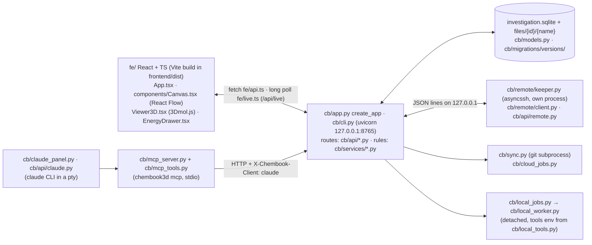

# Architecture map

A short map of Chembook3D for developers and coding agents: what runs, where each layer lives,
and how an output file becomes an energy. Read this first; then `grep -n "^## " docs/code-map.md`
for the feature you need. Paths are relative to the repository root; the backend is under
`src/chembook3d/` (written `cb/` below), the interface under `frontend/src/` (`fe/`).

## Processes

- WebSockets only for terminals: `/api/claude/terminal`, `/api/remote/terminal`.
- `cb/launcher.py` (desktop shortcut): progress page on :8764, `git pull`, rebuild if
  `frontend/` changed, then starts `chembook3d --launched`; `cb/api/lifetime.py` stops a launched
  server after the last tab closes.
- `cb/api/snapshot.py` + `fe/snapshot/`: the read-only HTML copy (second Vite build,
  `frontend/dist-snapshot/`).

## Layers

| Layer | Where | Notes |
|---|---|---|
| CLI and app | `cb/cli.py`, `cb/app.py`, `cb/settings.py` | App settings and tolerances in `settings.py`; config dir from platformdirs or `CHEMBOOK3D_CONFIG_DIR`. |
| Investigation folder | `cb/investigation.py` | Open/create, lock (`.chembook3d.lock`, `.chembook3d.owner`), back up then Alembic-migrate. |
| Records | `cb/models.py` | Node, Calculation, CalculationResult (1:1), LevelOfTheory, SourceFile, ReactionStep, Branch, GroupNode, Transition, TransitionSpecies, SubInvestigation, analyses, HistoryEntry. |
| HTTP routes | `cb/api/` | `routes.py` core + imports; `energies.py`, `pathway.py`, `live.py`, `jobs.py`, `local.py`, `remote.py`, `claude.py`, `batch_imports.py`, `import_undo.py`. A new route needs an MCP tool or a NOT_OFFERED entry in `tests/test_mcp.py`. |
| Domain rules | `cb/services/` | All rules (ID-*, INV-*, EN-*) live here, never in `fe/`. |
| Parsers | `cb/parsers/` | Own code, not cclib: `gaussian.py`, `orca.py`, `xtb.py`, `crest.py`, `cml.py`, `joined.py`, `local_result.py`; common types in `common.py`. |
| Thermochemistry | `cb/thermochem.py`, `cb/units.py` | Truhlar G_qh (D56–D58); CODATA 2018 constants. Oracle: `docs/reference/thermochem_corr_G16.py`. |
| History | `cb/services/history.py` | Append-only `history` table; `source` = manual, import or claude. |

## Import → energy pipeline

| Step | Code | Rule |
|---|---|---|
| 1. Stage | `services/imports.py` `Staging.add` | Temp copy + SHA-256; nothing in the database. |
| 2. Detect | `imports.read_file` | By content: local result, joined scan, xTB scan, Gaussian, CML, ORCA, xTB, CREST. |
| 3. Parse | `parsers/*` → `ParsedFile(program, version, steps)` | Correlated methods take their own total (D153); missing values → W-PARSE. |
| 4. Plan / preview | `imports.plan`, `services/levels.py`, `services/geometry.py` | Level key = program, method, basis, dispersion, solvation model, solvent. Attach if Kabsch RMSD ≤ 0.001 Å; W-DUP ≤ 0.05 Å (D62). |
| 5. Commit | `imports.commit` | One transaction, fixed write order (keep `tests/test_import_undo.py` green); file to `files/<source-file-id>/<name>`. |
| 6. Batch / undo | `services/batch_import.py`, `services/import_undo.py` | Undo replays the history in reverse. |
| 7. Energies | `services/energies.py` (`LevelKey`, `NodeEnergies`) | Composite level `levelId~geometryLevelId` (D31); same level only, no fallback (D27); other charge/multiplicity left out (D155). |
| 8. Thermo | `thermochem.py`, `services/thermo_settings.py`, `services/thermo_model.py`, `services/concentrations.py` | G_qh per investigation T/cutoff (D159); 1 M option (D95, D160). |
| 9. Checks | `services/warnings.py`, `services/spin.py`, `services/energies.py` | W-* codes travel in each value's `check`; they never change a value (D19). |
| 10. Analyses | `services/pathways.py`, `turnover.py`, `selectivity.py`, `equilibrium.py`, `group_populations.py` | Profiles, energetic span, selectivity, populations. |

## Tests

`tests/` (pytest, fixtures in `tests/fixtures/` with sources in its README), `frontend/e2e/`
(Playwright against the real backend on :8766). CI: `.github/workflows/ci.yml`, Ubuntu + Windows.
